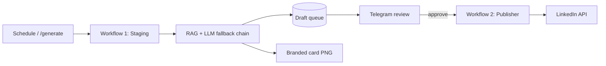

# linkedin-post-agent

[](https://github.com/<YOUR_USER>/linkedin-post-agent/actions)

I'm Mahmoud Almodalal, a backend-focused full-stack developer (Python/Django, Node.js, PostgreSQL, Docker) based in Berlin. This is an n8n pipeline that drafts technical LinkedIn posts, sends them to me on Telegram, and publishes only after I approve.

> **Transparency:** drafts are generated by AI (LLMs grounded in my own project notes) and are **reviewed and approved manually** by me before anything is published.

**Open to:** backend / Django roles in Berlin or remote EU, and freelance work. Languages: Arabic, English.

## What it does



<!-- TODO: add screenshot 1 (Telegram draft) and screenshot 2 (generated card). Remove personal IDs/tokens first. -->
_Screenshots: coming soon._

More detail: [docs/architecture.md](docs/architecture.md), [docs/spec.md](docs/spec.md), [docs/adr/](docs/adr).

## Design decisions & trade-offs

| Problem | Decision | Why | Cost |
|---|---|---|---|
| Generation and approval have different lifecycles | Two decoupled n8n workflows ([ADR 0004](docs/adr/0004-decoupled-workflows.md)) | Approval can happen hours later without a waiting execution | Shared state lives outside n8n |
| Waiting for human approval | Telegram commands plus inline buttons, no Wait nodes ([ADR 0001](docs/adr/0001-telegram-command-approval.md), [0006](docs/adr/0006-inline-callbacks-alongside-commands.md)) | Resilient to restarts | Two input paths to keep in sync |
| Concurrent draft IDs | `draft_store.js` on a SQLite document store: transactional writes ([ADR 0007](docs/adr/0007-sqlite-document-store.md)) | No ID collisions, IDs never reused | Needs Node 22+; JSON mirror kept for n8n code nodes |
| Grounding posts in real facts | `rag_engine.js`: BM25 + embeddings fused with RRF; works without embeddings | Still functions if the embedding API is down | Small corpus only |
| LLM outages / unstable models | Fallback chain OpenRouter → Gemini → Cloudflare Workers AI; unstable models rejected | Draft still gets produced | Quality varies by provider |
| Public webhook | Webhook secret + allowed user ID check; restricted env passed to subprocesses | Only I can drive the bot | Single reviewer |
| Public URL | ngrok ([ADR 0002](docs/adr/0002-tunnel-provider.md)) | Quick setup | Cloudflare Tunnel is the likely next step |

## What I built vs. what I used

| Area | Status |
|---|---|
| Node.js scripts (draft store, RAG, card renderer, Telegram router, LinkedIn publisher), workflow design, prompts | Written by me; **AI-assisted: TODO (state honestly how much)** |
| n8n, ngrok, Chromium, `@google/genai` | Used / configured |
| Gemini, OpenRouter, Cloudflare Workers AI, LinkedIn REST API, Telegram Bot API | Used / configured |

Honesty guard: all prompts forbid inventing incidents, clients, or metrics; only facts from the knowledge base may be used (`HONESTY_RULES` in `scripts/innovation_layer.js`).

## Quick start

Requirements: Docker, Node.js ≥ 20.

```bash
cp .env.example .env      # fill in the values below
docker compose up -d      # n8n + ngrok
npm install
npm test                  # unit/contract suite
```

Key `.env` variables: `NGROK_AUTHTOKEN`, `NGROK_DOMAIN`, `N8N_ENCRYPTION_KEY`, `GEMINI_API_KEY`, optional `OPENROUTER_API_KEY`, `CLOUDFLARE_ACCOUNT_ID`/`CLOUDFLARE_API_TOKEN`, `TELEGRAM_BOT_TOKEN`, `TELEGRAM_ALLOWED_USER_ID`, `TELEGRAM_WEBHOOK_SECRET`, `LINKEDIN_*`.

- **Telegram:** create a bot with @BotFather, then `npm run setup:telegram` and `node scripts/register_telegram_webhook.mjs`.
- **LinkedIn:** `npm run auth:linkedin` runs the OAuth2 flow and prints the access token and person URN.
- Import `workflows/*.json` into n8n.

## Limitations & what I'd do next

- The LinkedIn access token expires after ~60 days and there is no automatic refresh. Next: a Telegram reminder 7 days before expiry.
- Drafts are stored in JSON files; fine for one user, not for scale. Next: SQLite or PostgreSQL.
- Single reviewer, single LinkedIn account.
- No measured benchmarks yet (e.g. BM25 vs embeddings vs RRF); I won't claim any until I measure.

## Credits & contact

n8n, Google Gemini, OpenRouter, Cloudflare Workers AI, ngrok, Chromium.

- LinkedIn: <YOUR_LINKEDIN_URL>
- Email: <YOUR_EMAIL>

Licensed under [MIT](LICENSE).
